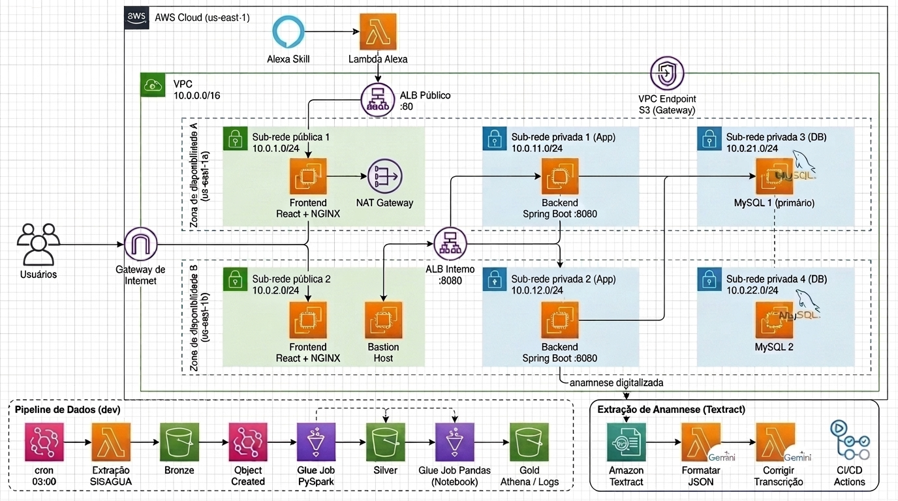
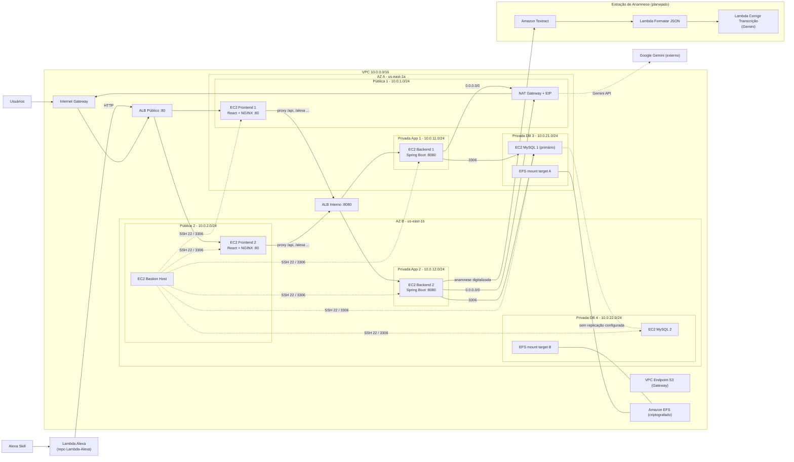
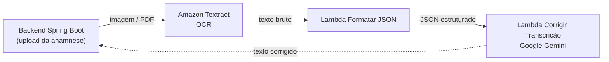
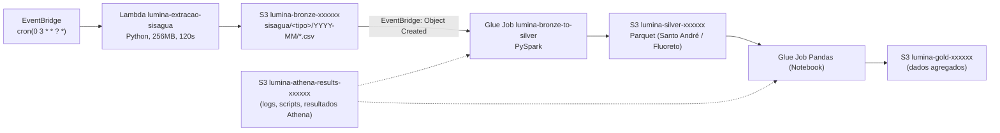

# Arquitetura de Infraestrutura LUMINA (estado atual do código)

> Fonte: leitura de `environments/`, `modules/`, `Terraform/` (legado), `.github/workflows/` e `scripts/`.
> **LocalStack desconsiderado.** Branch lida: `feat/data-pipeline-modules`.
> Referência visual anterior: [`Terraform/InfraImagem.v2.png`](../Terraform/InfraImagem.v2.png) · Proposta atualizada: [`InfraImagem.v3.jpg`](./InfraImagem.v3.jpg)

> ⚠️ A imagem v3 foi gerada por IA como referência. Ajustes pendentes ao editar no draw.io:
> o Bastion **não** recebe tráfego do ALB Interno, e o **Amazon EFS** (entre as sub-redes DB 3 e 4) sumiu do desenho.
> Use as seções abaixo e o diagrama Mermaid como fonte de verdade ao editar no draw.io.

---

## 1. Visão geral

| Item | Valor |
| :--- | :--- |
| Cloud / Região | AWS `us-east-1` (AWS Academy Learner Lab) |
| IaC | Terraform `>= 1.5.0` (CI usa `1.7.5`), sem backend remoto configurado |
| Raiz ativa | `environments/dev` e `environments/prod` (consomem `modules/*`) |
| Raiz legada | `Terraform/` (monolítico, base da imagem v2) |
| IAM | Sem roles próprias: usa `LabRole` e `LabInstanceProfile` (restrição SCP do Academy) |
| SO das EC2 | Ubuntu 22.04 (AMI Canonical), provisionadas via `user_data` (git clone + build) |

---

## 2. Diagrama (fonte de verdade – ambiente **prod**)

---

## 3. Rede (`modules/network`)

| Recurso | Detalhe |
| :--- | :--- |
| VPC | `10.0.0.0/16`, DNS hostnames/support habilitados |
| AZs | `us-east-1a`, `us-east-1b` |
| Sub-redes públicas | `10.0.1.0/24` (A), `10.0.2.0/24` (B) – IP público automático |
| Sub-redes privadas App | `10.0.11.0/24` (A), `10.0.12.0/24` (B) |
| Sub-redes privadas DB | `10.0.21.0/24` (A), `10.0.22.0/24` (B) |
| Internet Gateway | Rota `0.0.0.0/0` na RT pública |
| NAT Gateway | **1 único**, na **Pública 1 (AZ A)** com EIP – só em prod |
| Route tables | 1 pública + 1 privada (compartilhada por App e DB) |
| VPC Endpoint S3 | Tipo **Gateway**, associado às RTs pública e privada |
| ALB Público | Internet-facing, subnets públicas, listener `:80` → TG frontend (`/`, 200-399) |
| ALB Interno | Só em prod, subnets App, listener `:8080` → TG backend (`/actuator/health`) |

### Security Groups (menor privilégio)

| SG | Entrada |
| :--- | :--- |
| `alb-pub` | 80, 443 de `0.0.0.0/0` |
| `bastion` | 22 de `admin_ssh_cidr` (padrão `0.0.0.0/0`) |
| `frontend` | 80 do ALB Público · 22 do Bastion · (dev: 22 direto) |
| `alb-int` | 80 e 8080 do Frontend (prod) |
| `backend` | 8080 do ALB Interno (prod) · 22 do Bastion · (dev: 8080 do Frontend e do ALB Público, 22 direto) |
| `database` | 3306 do Backend, do Bastion e de si mesmo (replicação) · 22 do Bastion · (dev: 22 direto) |
| `efs` | 2049 (NFS) do Database e do Backend |

---

## 4. Computação (EC2)

| Camada | Módulo | Prod | Tipo | Sub-rede | Provisionamento |
| :--- | :--- | :---: | :--- | :--- | :--- |
| Frontend | `modules/frontend` | 2 | `t3.micro` | Públicas 1 e 2 | Node 20 + Vite build → NGINX; proxy reverso p/ `backend_endpoint:8080` (rotas `/alexa`, `/usuarios`, `/api`, `/actuator`...) |
| Backend | `modules/backend` | 2 | `t3.small` | Privadas App 1 e 2 | Java 21 + Maven, systemd `lumina-backend`, JWT, Gemini API key |
| Database | `modules/database` | 2 | `t3.small` | Privadas DB 3 e 4 | MySQL Server + carga `lumina.sql` do repo `Banco-de-dados` |
| Bastion | `environments/prod/main.tf` | 1 | `t3.micro` | Pública 2 (AZ B) | NGINX (jump host) |

- Repositórios clonados: `Back-end`, `Front-End`, `Banco-de-dados` (branch `feat/lambda-alexa`).
- Key pair: `modules/keypair` (`lumina-deploy-key`).
- **Ambos os backends usam `module.database.primary_private_ip`** → apenas o MySQL 1 recebe tráfego.

## 5. Armazenamento

| Recurso | Ambiente | Detalhe |
| :--- | :--- | :--- |
| Amazon EFS | prod | `generalPurpose`, `bursting`, criptografado; mount targets nas sub-redes DB 3 e 4 |
| S3 (via VPC Endpoint) | ambos | Acesso privado ao S3 a partir das RTs |

## 6. Serverless / Integrações

| Recurso | Ambiente | Detalhe |
| :--- | :--- | :--- |
| Lambda Alexa | dev + prod | Módulo externo `../../../Lambda-Alexa/terraform`; chama `http://<ALB Público>` com usuário técnico |
| Google Gemini | dev + prod | Chamado pelo backend (saída via NAT em prod) – fora da AWS |
| Fluxo Textract (anamnese) | **planejado** | Ver seção 6.1 |

### 6.1 Extração de Anamnese Digitalizada – Amazon Textract (**planejado**)

Fluxo que será usado para extrair o texto das fichas de anamnese digitalizadas.

| Etapa | Serviço | Função |
| :--- | :--- | :--- |
| 1 | Amazon Textract | OCR do documento digitalizado enviado pelo backend |
| 2 | Lambda **Formatar JSON** | Normaliza a saída do Textract em JSON (`text`, `timestamp`, `status`) |
| 3 | Lambda **Corrigir Transcrição** | Usa Gemini para corrigir erros de OCR e devolver o texto final |

> [!NOTE]
> Hoje só existe um esboço no legado [`Terraform/lambda.tf`](../Terraform/lambda.tf)
> (`formatar_json` e `corrigir_transcricao`, este ainda apontando para **Bedrock**).
> Ainda **não** há módulo em `modules/` nem chamada em `environments/`; falta criar o módulo,
> trocar Bedrock por Gemini e definir o gatilho (ex.: upload em S3 ou chamada direta do backend).

## 7. Pipeline de Dados – Medalhão (**somente `environments/dev`**)

- Buckets com sufixo aleatório de 6 chars, `force_destroy`, bloqueio de acesso público.
- CloudWatch Log Group da Lambda com retenção de 7 dias.

---

## 8. CI/CD (GitHub Actions)

| Workflow | Gatilho | Ações |
| :--- | :--- | :--- |
| `terraform-ci.yml` | push/PR em `main`, `develop`, `feat/ci-cd` | Checkout Lambda-Alexa, `terraform fmt -check`, `validate` dev e prod |
| `terraform-deploy.yml` | `workflow_dispatch` | `apply`/`destroy` em `dev`/`prod` com credenciais temporárias do Learner Lab |

Script local: `scripts/lumina-infra.sh` (`up`, `down`, `plan`, `outputs`, `validate`).

---

## 9. Dev × Prod

| Aspecto | dev (econômico) | prod (apresentação) |
| :--- | :--- | :--- |
| EC2 | 3 (1 FE, 1 BE, 1 DB) – todas na **Pública 1** com IP público | 7 (2 FE, 2 BE, 2 DB, 1 Bastion) |
| NAT Gateway | ❌ | ✅ (1, AZ A) |
| ALB Interno | ❌ (FE → IP privado do BE) | ✅ |
| ALB Público | ✅ | ✅ |
| EFS | ❌ | ✅ |
| Bastion | ❌ (SSH direto) | ✅ |
| Pipeline de dados | ✅ | ❌ |

---

## 10. O que mudar na imagem v2 → v3

| # | Elemento na v2 | Situação no código | Ação |
| :-: | :--- | :--- | :--- |
| 1 | Route 53 (globo roxo à esquerda) | Não existe | Remover (ou marcar "futuro") |
| 2 | Ícone superior (Transcribe) → Lambda | Lambda existente é a **Alexa**, fora da VPC, chamando o ALB Público | Trocar por Alexa Skill → Lambda Alexa → ALB Público |
| 3 | NAT junto ao EC2 da Pública 2 | NAT fica na **Pública 1 (AZ A)**; Pública 2 tem o **Bastion** | Mover NAT para Pública 1; rotular EC2 da Pública 2 como Bastion |
| 4 | Ícone no centro-direita entre DBs | É o **Amazon EFS** com mount targets nas DB 3 e 4 | Rotular "Amazon EFS" |
| 5 | Linha tracejada DB ↔ DB | SG permite 3306 entre DBs, mas **não há replicação configurada** | Manter tracejado com nota "replicação não configurada" |
| 6 | Backends → DBs | Ambos apontam para o **MySQL 1** | Setas dos dois backends para MySQL 1 |
| 7 | Bucket S3 genérico no topo | Só o VPC Endpoint Gateway existe; buckets são os do pipeline | Ligar o endpoint ao grupo de buckets / remover bucket avulso |
| 8 | Data Lake Bronze/Silver/Gold isolado | Existe (dev) com Lambda extração, EventBridge e Glue | Adicionar EventBridge cron → Lambda → Bronze → EventBridge → Glue → Silver → Gold + bucket Athena |
| 9 | Pipeline Textract → "Formatar JSON" → "Corrigir Transcrição" (Gemini) | **Planejado** para a anamnese digitalizada; só há esboço no legado `Terraform/lambda.tf` | **Manter** no diagrama (rotular "Extração de Anamnese – Textract") |
| 10 | Sem CI/CD | GitHub Actions CI + Deploy | (Opcional) adicionar caixa CI/CD |
| 11 | Sem portas/CIDRs | — | Adicionar CIDRs das sub-redes e portas `:80` / `:8080` / `3306` |

---

## 11. Pontos de atenção

- `admin_ssh_cidr` padrão `0.0.0.0/0` no Bastion.
- Segredos com valores padrão em `variables.tf` (`db_password`, `jwt_secret`, `alexa_service_password`).
- NAT único: queda da AZ A deixa os backends da AZ B sem saída à Internet.
- ALB Público só escuta `:80` (SG libera 443, mas não há listener HTTPS).
- Pipeline de dados não existe em prod; URLs do SISAGUA na Lambda ainda são placeholders.
- Fluxo Textract ainda não está nos módulos/ambientes; a Lambda de correção do legado usa Bedrock em vez de Gemini.
- `origin/main` recebeu commits novos que não estão nesta branch — revisar após merge.
